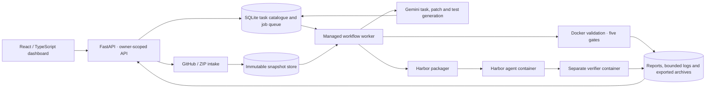

# MIRAI

MIRAI is the Coding Task Factory platform for Innodata AI Hackathon 2026, Track 1. The public landing page is at `/`, the About page at `/about`, and the saved workspace at `/dashboard`. Existing workflow URLs and storage locations are preserved.

**Innodata AI Hackathon 2026 · Track 1**

MIRAI turns a working repository into a reproducible software-engineering task. It records the starting version, generates a specification and candidate patch, maps requirements to native tests, runs independent validation gates, and exports a Harbor task for agent evaluation.

Start with the [submission guide and evidence](docs/submission/README.md), [five-minute demo](docs/submission/DEMO.md), or [API reference](docs/submission/API.md).

## Architecture



- `backend/app/routers` defines ingestion, task, job, history and evaluation APIs. `backend/app/services` owns snapshot verification, bounded model inputs, native testing, Docker control, Harbor packaging and persistence.
- `frontend/src` contains the Vite dashboard. Browser storage remembers selected IDs. SQLite and the evidence stores are authoritative.
- Validation is snapshot-backed and uses fresh environments for baseline, reference/build, feature, regression and negative-control checks. `VALIDATED` requires all five gates.
- The Harbor agent receives the starting source and public task instruction. Hidden tests run in an independent verifier. The oracle is evaluator-only.

## Requirements

- Windows 11, Docker Desktop with WSL2 and Linux containers, and an account allowed to launch Docker jobs. The trusted controller uses the Windows Docker CLI. Source and generated tests execute in restricted Linux workloads.
- Python 3.11+ for FastAPI and Node.js 22 with npm for the frontend. Harbor CLI **0.25.0** uses a separate Python 3.12+ environment.
- For live generation, a backend Gemini API key with access to `gemini-3.8-flash`. Controls and the demo replay require no model credentials. A live Harbor agent campaign requires an allowed OpenAI model and host-side provider credential. [Gemini model documentation](https://ai.google.dev/gemini-api/docs/models/gemini-3.8-flash)
- Supported executable targets are Python repositories with native `pytest` or `unittest`, supported static dependency manifests, and an approved offline wheelhouse when needed.

## Windows installation

From the repository root in PowerShell, create a local environment and configure the backend.

```powershell
py -3.11 -m venv backend/.venv
& backend/.venv/Scripts/python.exe -m pip install -r backend/requirements.txt
Copy-Item .env.example backend/.env
```

Set values in `backend/.env` or use the process environment. Keep that file private. Start the backend from `backend` in one terminal.

```powershell
Set-Location backend
& .venv/Scripts/python.exe -m uvicorn app.main:app --host 127.0.0.1 --port 8000
```

Start the frontend from `frontend` in another terminal.

```powershell
Set-Location frontend
npm ci
npm run dev
```

Open [the local dashboard](http://localhost:5173). Vite proxies workflow API paths to port 8000. [Interactive OpenAPI](http://127.0.0.1:8000/docs) is available in local mode. If serving the Vite production build, route API requests to the backend on the same origin, or set `VITE_API_BASE_URL` at build time and allow the explicit browser origin.

### Docker and Harbor

With Docker Desktop running in Linux mode, verify the engine, Compose plugin and approved image.

```powershell
docker version
docker compose version
docker pull docker.io/library/python@sha256:07d4824036af339fa1b6ef769cc99d9c10a141769538b52b3b597c84f7a7b535
docker image inspect docker.io/library/python@sha256:07d4824036af339fa1b6ef769cc99d9c10a141769538b52b3b597c84f7a7b535 --format '{{.Id}}'
uv tool install --python 3.12 harbor==0.25.0
harbor --version
```

Set the image ID in `CTF_VALIDATION_IMAGE`. Verified Harbor export requires Docker validation using the matching runtime and dependency lock. The [Docker runner setup](docs/PHASE_4_DOCKER_VALIDATION.md) describes the engine checks and resource limits. The [Harbor format and execution guide](docs/PHASE_5_HARBOR.md) describes the separate verifier. [Evaluation setup and metrics](docs/PHASE_6_EVALUATION.md) explains live agents, admission controls, and result interpretation.

### Environment variables

| Setting | Purpose |
| --- | --- |
| `GEMINI_API_KEY` | Backend-only generation credential |
| `GEMINI_MODEL` | Optional model override for task, solution and test generation. Defaults to `gemini-3.8-flash`. |
| `OPENAI_API_KEY` | Host-side evaluation provider credential |
| `HF_TOKEN` | Hugging Face Inference Providers token for direct evaluation or a configured OpenAI fallback |
| `CTF_VALIDATION_IMAGE` | Approved full local Linux image ID |
| `CTF_VALIDATION_WHEELHOUSE` | Absolute directory holding SHA-256-pinned wheels and `requirements.lock` |
| `CTF_HARBOR_EXECUTABLE` | Absolute path to Harbor 0.25.0 when it is outside PATH |
| `CTF_STATE_DIR`, `CTF_SNAPSHOT_DIR` | Service-owned SQLite catalogue and immutable snapshot storage |
| `CTF_VALIDATION_REPORT_DIR`, `CTF_EVALUATION_DIR` | Service-owned validation and evaluation evidence storage |
| `CTF_SHARED_MODE`, `CTF_ACCESS_TOKENS`, `CTF_ALLOWED_ORIGINS` | Shared HTTPS mode, operator principals and exact allowed origins |
| `CTF_REQUESTS_PER_MINUTE`, `CTF_MODEL_REQUESTS_PER_DAY`, `CTF_GLOBAL_MODEL_REQUESTS_PER_DAY` | HTTP and model admission limits |
| `CTF_AGENT_MODELS` | Comma-separated allowlist for shared live evaluation |
| `APP_NAME`, `ENV` | Application metadata and environment |
| `VITE_API_BASE_URL` | Optional frontend API origin at build time |

## Workflow

1. Add a public GitHub repository or ZIP in **New Project**. Supply a full GitHub commit SHA to reproduce a specific revision. A ZIP receives a content-addressed identity.
2. Review the snapshot checksum, detected languages, test framework and repository structure. Generate a contextual task.
3. Generate and inspect the reference changes. Generate tests and review the requirement and acceptance-criterion coverage alongside the untouched original suite.
4. Run **Validation** and inspect commands, logs and five gate results. The original implementation must fail the new behavior checks in the negative control.
5. Build and download the **Harbor Export**. Share the full ZIP only with the evaluator since it contains the oracle and hidden test assets.
6. Run **Agent Evaluation** controls or a configured live campaign. Inspect the oracle, no-op and agent trials separately. Export JSON from the API and CSV summaries from the dashboard.
7. Return to the dashboard to reopen saved tasks and historical evidence.

The [API reference](docs/submission/API.md) documents request bodies, status codes and evidence retrieval. [Phase 7 storage and access](docs/PHASE_7_WORKFLOW.md) lists the SQLite tables, migrations and deployment boundaries.

## Testing and reproducibility

```powershell
# In the backend environment, from backend/
python -m pip check
python -B -m unittest discover -s tests -v

# From frontend/
npm run build

# From the repository root, against the production build
node frontend/tests/workflow.browser.mjs "<Chrome or Edge executable>" frontend/dist
```

Run the ordinary backend checks inside an offline test container. The [submission evidence](docs/submission/README.md) gives the exact settings for the live public-repository run, opt-in Docker tests and Harbor oracle/no-op jobs. Use the recorded commit, archive hash, native dependency lock and runtime image for reproduction. New runs produce new task and run IDs. Reproduce experiment inputs and observed behavior rather than comparing timestamps or newly generated IDs.

## Security and limitations

- GitHub intake restricts hosts, pins a validated public address while preserving TLS hostname validation, and verifies archive redirects. ZIP intake enforces size, path, link and extraction limits. Snapshot bytes are verified on reuse.
- Generation treats repository data as untrusted. Structural checks alone confer no validation status. Docker workloads have network disabled, resource limits, restricted privileges and no Docker socket or credential mount. The Docker control plane and local service account are trusted.
- The operator approves runtime images and wheels. Source code still runs inside a shared-kernel isolation boundary. A dedicated execution host with tighter isolation is needed for hostile multi-tenant workloads. Inspect shared-mode origin, TLS, operator tokens and disk retention before exposing the API.
- Native execution and Harbor packaging are Python-only. Contextual tasks may be proposed for other languages. Executable support for Java and JavaScript/TypeScript remains unverified.
- Pipeline admissibility is intentionally bounded. Unsupported build setups, dependencies, skipped tests, malformed evidence, or a missing runner do not yield a successful validation.
- Provider credentials and external availability affect live generation and agent evaluation. The evidence guide states which stages used replay and which ran against real infrastructure.

## Hackathon requirement mapping

| Requirement | Implementation and evidence |
| --- | --- |
| Reusable strategy grounded in working repositories | Snapshot ingestion, source-aware generation and native test selection. [Phase 1](docs/PHASE_1_SNAPSHOTS.md), [Phase 2](docs/PHASE_2_SOURCE_AWARE_SOLUTIONS.md), [Phase 3](docs/PHASE_3_NATIVE_TEST_SUITES.md) |
| Clear requirements and working implementation | Structured task, traceable reference edits, and build evidence. [Submission bundle](docs/submission/README.md) |
| Feature and regression coverage | Criterion mapping, original test fingerprints, native feature and regression receipts. [Validation gates](docs/PHASE_4_DOCKER_VALIDATION.md) |
| Exact initial version | Verified GitHub commit, snapshot ID, ZIP SHA-256 and file manifest. [Snapshot contract](docs/PHASE_1_SNAPSHOTS.md) |
| Standard task interface | Harbor schema 1.4, pinned environment, oracle and separate verifier. [Harbor guide](docs/PHASE_5_HARBOR.md) |
| Empirical results | Docker receipts and Harbor rewards with explicit scope. [Submission evidence](docs/submission/README.md) |

See the [implementation plan](docs/IMPLEMENTATION_PLAN.md) for phase history.
