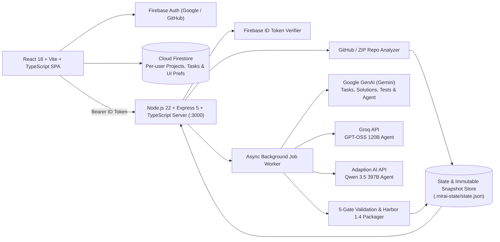

# MIRAI — Coding Task Factory

**Innodata AI Hackathon 2026 · Track 1**

MIRAI is a full-stack **Coding Task Factory** platform that turns real software repositories into reproducible, evidence-backed coding benchmarks. From a single workspace, it captures an immutable repository snapshot, generates a grounded feature specification and reference solution, creates traceable feature and regression tests, runs five isolated validation gates, packages a Harbor-compatible benchmark archive, and evaluates multiple frontier coding agents side by side.

- **Public pages**: Landing (`/`), About (`/about`)
- **Authenticated workspace**: Dashboard (`/dashboard`), New Project (`/new-project`), Task Generator (`/task-generator`), Reference Solution (`/solution`), Test Suite (`/test-suite`), Validation (`/validation`), Harbor Export (`/export`), Agent Evaluation (`/evaluation`), Settings (`/settings`)

---

## Key Capabilities

- **Immutable Repository Intake**: Ingest public GitHub repositories (with optional commit SHA pinning) or `.zip` uploads with SHA-256 content addressing, file manifests, language detection, and framework discovery.
- **Source-Aware Task, Patch & Test Generation**: Powered by the official `@google/genai` SDK (`gemini-4-hydrogen` by default) to produce structured specifications, reviewable file-level reference patches, and requirement-mapped tests that preserve existing regression suites.
- **5-Gate Real Isolated Validation**: Executes baseline syntax/tests, reference patch application + compile verification (`py_compile` / `node --check`), real feature test execution, real regression test execution, and real untreated-baseline negative control (confirming feature tests genuinely fail without the solution) in fresh secret-stripped temporary workspaces.
- **Complete Harbor 1.4 Benchmark Packaging**: Exports downloadable Harbor 1.4 ZIP packages containing `task.toml`, `instruction.md`, `metadata.json`, `environment/Dockerfile`, `environment/repo/`, `solution/solve.sh` + `solution/files/`, and `tests/test.sh` (which copies hidden tests, runs feature + regression suites, and always writes `1.0` or `0.0` to `/logs/verifier/reward.txt`).
- **Real Multi-Provider Stage 5 Agent Evaluation**: Executes Oracle and Baseline No-Op controls plus live coding agents across three providers — **Gemini** (`gemini/gemini-4-hydrogen`), **GPT-OSS 120B** (`groq/openai/gpt-oss-120b`), and **Qwen 3.5 397B** (`adaption/qwen3.5-397b`, 131K context, plus optional `adaption/qwen-SEA-LION-v5-397b-a17b-plus`, 262K context) — scoring every submission with real isolated build, feature, and regression test execution.
- **Firebase Auth & Cloud Persistence**: Google and GitHub Sign-In with owner-scoped Cloud Firestore persistence (`users/{uid}`, `users/{uid}/projects`, `users/{uid}/tasks`) and **1-click Restore & Open** directly from the Dashboard so historical repositories and tasks survive across sessions and restarts.
- **Mobile-Responsive & Theme-Aware UI**: Light/Dark theme support (stored locally) and full mobile responsiveness featuring an off-canvas slide-over navigation drawer, adaptive layouts, and touch-friendly controls.

---

## Architecture



### Repository Structure

```text
.
├── server.ts                  # Express 5 API + SPA server (port 3000)
├── server/
│   ├── repoAnalyzer.ts        # GitHub & ZIP intake, SHA-256 snapshot & metadata extraction
│   ├── sandboxRunner.ts       # Isolated temp-workspace execution, syntax check & Python/Node test runner
│   ├── gemini.ts              # @google/genai task, solution, test & Gemini agent runner
│   ├── groq.ts                # Groq OpenAI-compatible client (GPT-OSS 120B)
│   ├── adaption.ts            # Adaption AI client (Qwen 3.5 397B, JSON mode & retry logic)
│   ├── harborBuilder.ts       # Real 5-gate validation, Harbor 1.4 ZIP builder & empirical agent verifier
│   ├── firebaseAuth.ts        # Server-side Firebase ID token verification
│   ├── store.ts               # Owner-scoped snapshots, tasks, jobs, artifacts & logs store
│   └── types.ts               # Shared backend TypeScript contracts
├── frontend/
│   ├── src/
│   │   ├── pages/             # Landing, About, Dashboard, NewProject, TaskGenerator,
│   │   │                      # ReferenceSolution, TestSuite, Validation, HarborExport,
│   │   │                      # Evaluation, Settings
│   │   ├── components/        # AppSidebar (responsive drawer), TopNavbar, AuthGate,
│   │   │                      # CodeViewer, ThemeToggle, ErrorBoundary
│   │   ├── context/           # AuthContext, ProjectContext, ThemeContext
│   │   ├── services/          # apiClient, workflowService, firestoreSync, firebase
│   │   └── styles/            # index.css, marketing.css
│   └── public/                # Static brand assets
├── firestore.rules            # Strict owner-scoped Cloud Firestore security rules
├── firebase-blueprint.json    # Firestore data model & schema blueprint
├── .env.example               # Environment variable template
├── package.json               # Root scripts, dependencies & npm workspace config
└── tsconfig.server.json       # Server TypeScript configuration
```

---

## Prerequisites

- **Node.js 22+** and **npm** (runs `server.ts` natively with TypeScript support)
- **Python 3.11+** (optional/recommended when running live Python `pytest`/`unittest` validation suites locally)
- API keys for the providers you want to use:
  - `GEMINI_API_KEY` — required for task, reference solution, test suite generation, and Gemini agent evaluation
  - `GROQ_API_KEY` — required for live **GPT-OSS 120B** agent evaluation
  - `ADAPTION_API_KEY` — required for live **Qwen 3.5 397B** agent evaluation

---

## Quick Start

1. **Install dependencies** (root + frontend workspace):

   ```bash
   npm install
   ```

2. **Configure environment variables**:

   Copy `.env.example` to `.env` and populate your server-side provider keys (never commit `.env` or expose keys to the browser):

   ```bash
   cp .env.example .env
   ```

3. **Build the frontend SPA**:

   ```bash
   npm run build
   ```

4. **Start the unified server on port 3000**:

   ```bash
   npm run dev
   ```

   Open `http://localhost:3000`. The Express server serves both the REST API and the compiled frontend SPA from `frontend/dist` on the same origin.

5. **Type-check frontend and backend**:

   ```bash
   npm run lint
   ```

---

## Environment Variables

| Variable | Default | Purpose |
| --- | --- | --- |
| `APP_NAME` | `MIRAI` | Application display name |
| `ENV` | `development` | Runtime environment (`development` / `production`) |
| `PORT` | `3000` | Server port (binds to `0.0.0.0`) |
| `GEMINI_API_KEY` | — | Backend Google GenAI API key for generation and Gemini evaluation |
| `GEMINI_MODEL` | `gemini-4-hydrogen` | Default Gemini model used across generation and Stage 5 evaluation |
| `GROQ_API_KEY` | — | Backend Groq API key for `groq/openai/gpt-oss-120b` evaluation |
| `ADAPTION_API_KEY` | — | Backend Adaption AI API key for `adaption/qwen3.5-397b` evaluation |
| `ADAPTION_BASE_URL` | `https://api.prod.adaptionlabs.ai/api/v1` | Adaption AI OpenAI-compatible Chat Completions base URL |
| `GITHUB_TOKEN` | — | Optional GitHub PAT to increase GitHub repository ingestion rate limits |
| `LEGACY_OWNER_EMAIL` | — | Optional email for claiming pre-auth local `.mirai-state` records |
| `CTF_SHARED_MODE` | — | Optional shared-mode flag |
| `CTF_REQUESTS_PER_MINUTE` | — | Optional HTTP rate limit configuration |
| `CTF_MODEL_REQUESTS_PER_DAY` | — | Optional per-user daily model request budget |
| `CTF_GLOBAL_MODEL_REQUESTS_PER_DAY` | — | Optional global daily model request budget |
| `VITE_API_BASE_URL` | `""` (same origin) | Optional frontend API origin override at build time |

---

## End-to-End Workflow

1. **Sign In & Open Dashboard**: Sign in with Google or GitHub. Existing projects and tasks saved in Cloud Firestore appear immediately on `/dashboard`, with **Restore & Open** support for archived cloud records.
2. **Import Repository (`/new-project`)**: Provide a public GitHub repository URL (optionally pinned to a commit SHA) or upload a `.zip` archive to generate a SHA-256 verified immutable snapshot.
3. **Generate Task (`/task-generator`)**: Create a contextual feature task grounded in the repository's real files, or generate a standalone topic task.
4. **Reference Solution (`/solution`)**: Generate and inspect reviewable file-level changes applied against the immutable snapshot.
5. **Test Suite (`/test-suite`)**: Generate native tests mapped to requirements and acceptance criteria while keeping original regression tests intact.
6. **5-Gate Validation (`/validation`)**: Execute baseline, build/apply, feature, regression, and negative-control gates and review full execution logs.
7. **Harbor Export (`/export`)**: Build and download a Harbor 1.4-compatible `.zip` benchmark package containing the starting source, instruction, oracle solution, and verifier.
8. **Agent Evaluation (`/evaluation`)**: Run Oracle/No-Op controls and live multi-model trials (Gemini, GPT-OSS 120B via Groq, Qwen 3.5 397B via Adaption AI), inspect per-trial logs and rewards, and download `summary.csv` or `trials.csv`.

---

## API Overview

All workspace endpoints require a valid Firebase ID token in the `Authorization: Bearer <token>` header.

| Method & Path | Description |
| --- | --- |
| `GET /health` | Health check (`{"status":"healthy"}`) |
| `GET /auth/session` | Inspect current Firebase session status |
| `GET /evaluation/providers` | Check configured status and default models for Gemini, Groq, and Adaption AI |
| `GET /projects` | List user-scoped analyzed projects |
| `GET /snapshots/:snapshotId` | Retrieve immutable snapshot analysis metadata |
| `POST /tasks/analyze/github` | Analyze and snapshot a GitHub repository (with optional `commit_sha`) |
| `POST /tasks/analyze/upload` | Analyze and snapshot an uploaded `.zip` repository archive |
| `GET /tasks` | List user-scoped tasks with search and filters |
| `POST /tasks/generate` | Generate a topic-based coding task |
| `POST /tasks/generate/from-repo` | Generate a contextual coding task from a repository snapshot |
| `POST /tasks/restore` | Re-hydrate a saved Firestore cloud task (and GitHub snapshot) into active server state |
| `GET /tasks/:taskId` | Fetch full task detail, latest artifacts, and state |
| `POST /tasks/:taskId/jobs` | Enqueue an async `solution`, `tests`, `validation`, `export`, or `evaluation` job |
| `GET /jobs/:jobId` / `DELETE /jobs/:jobId` | Poll job status or cancel an active job |
| `GET /tasks/:taskId/history/:kind` | List historical artifact runs for a task |
| `GET /history/:kind/:recordId` | Fetch a specific historical artifact JSON payload |
| `GET /history/export/:recordId/download` | Download a generated Harbor 1.4 `.zip` archive |
| `GET /history/validation/:recordId/logs/:name` | View raw validation gate execution logs |
| `GET /history/evaluation/:recordId/logs/:name` | View raw per-trial agent evaluation logs |
| `GET /history/evaluation/:recordId/:formatName` | Export evaluation `summary.csv` or `trials.csv` |

---

## Security & Data Isolation

- **Per-User Authentication & Scoping**: Every workspace API route verifies the Firebase ID token via `server/firebaseAuth.ts` and scopes snapshots, tasks, jobs, and historical artifacts strictly to the authenticated user's UID.
- **Firestore Security Rules**: `firestore.rules` enforces `request.auth.uid == userId`, verified-email write checks, and `ownerId` validation on all reads and writes under `users/{userId}`, `users/{userId}/projects`, and `users/{userId}/tasks`.
- **Server-Side Secrets Only**: `GEMINI_API_KEY`, `GROQ_API_KEY`, and `ADAPTION_API_KEY` are read exclusively on the backend and never exposed to client bundles.
- **Safe Ingestion & Response Headers**: Archive uploads enforce size and `.zip` validation, and responses include `Cache-Control: no-store`, `X-Content-Type-Options: nosniff`, and `Referrer-Policy: no-referrer`.

---

## Hackathon Requirement Mapping

| Track 1 Requirement | MIRAI Implementation |
| --- | --- |
| **Reusable strategy grounded in working repositories** | GitHub/ZIP snapshot analyzer (`server/repoAnalyzer.ts`) + source-aware task, patch, and test generation (`server/gemini.ts`) |
| **Clear requirements & working reference implementation** | Structured problem statements, acceptance criteria, and file-level diffable reference patches |
| **Feature & regression coverage** | Requirement-to-test traceability while preserving original repository test suites |
| **Exact initial version** | Immutable snapshot IDs, GitHub commit SHA pinning, and SHA-256 archive hashes |
| **Standard task interface** | Harbor 1.4 archive packaging (`server/harborBuilder.ts`) separating public instructions, oracle, and verifier |
| **Empirical agent evaluation** | Oracle/No-Op controls + multi-model evaluation across Gemini, Groq GPT-OSS 120B, and Adaption Qwen 3.5 397B with downloadable logs & CSV exports |
